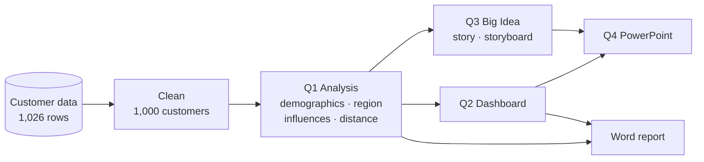

# SunVolt Energy: Solar Backup Customer Analysis
**ITCDA4-34 Project · Questions 1–4**

One notebook analyses 1,000 SunVolt customers and answers Questions 1–4. The finished PowerPoint and Word report are in `outputs/`.

## Project files
```
SunVolt/
├── SunVolt_Analysis.ipynb            ← all code: Q1 analysis → Q2 dashboard → Q3 story → Q4
├── SunVolt Solar Customer Data.xlsx  ← source data (myLMS)
├── outputs/
│   ├── figures/                      ← 4 Q1 charts + Q2 dashboard (PNG)
│   ├── SunVolt_Presentation.pptx     ← Q4 slides with speaker notes
│   └── SunVolt_Report.docx           ← full report (19 pp, 13 figures, slide-by-slide script)
├── requirements.txt
└── README.md
```

## How it fits together


## Key findings
| Theme | Result |
|---|---|
| Overall adoption | **48.1%** (481 of 1,000 customers) |
| Region | Pacific **58.9%** · Europe 49.3% · North America **43.3%** (288 non-buyers) |
| Installer distance | ≤ 5 km **53.4%** vs > 5 km **36.0%** |
| Age | 30–39 **59.5%** · 60+ 32.2% |
| Household | 0–1 vehicles 57–61% vs 2+ vehicles 36–39% · 5 dependents 22.2% |
| Gender | No effect (48.9% vs 47.4%) |

**Big Idea:** *SunVolt's customers already want solar backup. By bringing installers closer, financing families and multi-car households, and targeting young professionals, we can turn 48% adoption into market leadership, starting in North America.*

## Run it
```bash
pip install -r requirements.txt
jupyter lab SunVolt_Analysis.ipynb      # then Run → Run All
```
Running the notebook regenerates the charts in `outputs/figures/`.

**Q4 video:** open `outputs/SunVolt_Presentation.pptx`, choose *Slide Show → Record*, then *File → Export → Create a Video*. Keep it under 10 minutes and upload the MP4.
